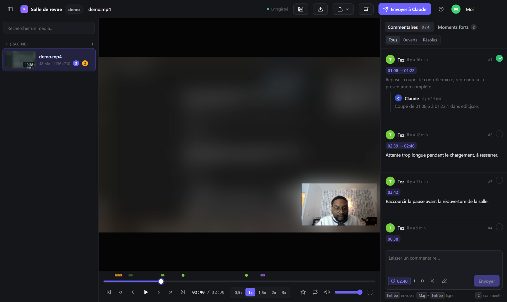
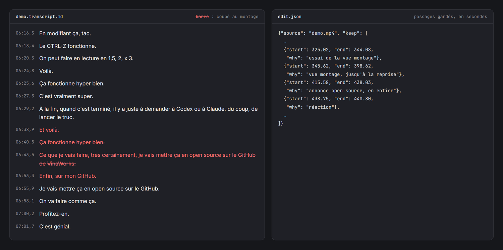
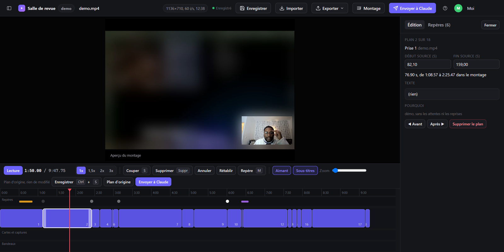
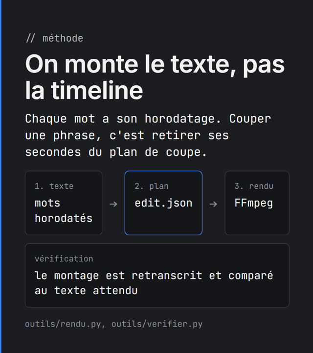

# studio-montage

Monter un podcast ou une vidéo face caméra en éditant le texte, pas la timeline.

On transcrit la vidéo au mot près, on décide quoi garder dans un fichier JSON lisible, et FFmpeg rend le montage à l'image près. Un script retranscrit ensuite le résultat pour vérifier qu'aucun mot n'a sauté. Le même matériau sert aux sous-titres, aux illustrations mi-écran et aux shorts verticaux.

Le dépôt réunit des scripts Python, une salle de revue locale pour commenter les préécoutes, et un wiki qui explique la méthode et les réglages qui marchent. Il est pensé pour travailler seul ou avec un agent de code (Claude Code, Codex) qui lit la transcription et propose le plan de coupe.



## Ce que ça fait

- **Transcription au mot** avec faster-whisper (`large-v3-turbo`), sur carte NVIDIA ou sur processeur.
- **Plan de coupe en JSON** (`edit.json`) : la liste des passages à garder, en secondes, avec la raison de chaque coupe.
- **Rythme** : repérage des hésitations, faux départs et silences trop longs à partir d'un plan éditorial.
- **Rendu FFmpeg** coupé à l'image, son au sample près, micro-fondu de 20 ms à chaque raccord pour éviter les clics.
- **Vérification sans écoute** : le montage est retranscrit et comparé au texte attendu.
- **Sous-titres** recalculés pour la vidéo montée.
- **Illustrations mi-écran** et **shorts 9:16** avec sous-titres mot à mot, aux couleurs d'un thème configurable.
- **Salle de revue** dans le navigateur : lecture jusqu'à x3, commentaires au timecode, moments forts, export vers un plan de coupe. Rien ne quitte la machine.

## Comment ça marche

```
vidéo ──> transcrire.py ──> transcript.json (mots horodatés)
                                  │
                   relecture, plan éditorial, salle de revue
                                  │
                                  v
                             edit.json ──> rendu.py ──> vidéo montée
                                  │                         │
                                  ├──> sous_titres.py ──> .srt
                                  └──> verifier.py <────────┘
```

Le texte est la référence : on coupe sur les bornes des mots, on relit, on corrige le JSON, on rend à nouveau. Aucune source n'est écrasée, aucun rendu n'est remplacé.



## Prérequis

- **Windows** avec PowerShell. C'est la seule plateforme testée ; les scripts sont en Python et devraient tourner ailleurs avec peu de changements, sans garantie.
- **Python 3.12**.
- **FFmpeg et FFprobe** dans le `PATH`.
- **Google Chrome ou Chromium**, seulement pour les illustrations et les shorts. Le chemin est trouvé tout seul, ou donné par la variable `CHROME`.
- **Une carte NVIDIA** conseillée : la transcription va bien plus vite, et la préécoute rapide (`rendu.py --apercu`) utilise l'encodeur NVENC. Sans carte, la transcription passe sur le processeur.
- **Node.js**, seulement pour contribuer (hooks Git).

## Installation

```powershell
git clone https://github.com/vina-works/studio-montage.git
cd studio-montage
python -m venv $HOME\.video-env
& $HOME\.video-env\Scripts\python.exe -m pip install -r outils\requirements.txt
```

Le premier lancement de `transcrire.py` télécharge le modèle Whisper (environ 1,6 Go).

## Premier montage

Les outils se lancent depuis `outils/`. Range ton travail dans `episodes/` : git ignore ce dossier, tes vidéos et tes plans restent chez toi.

```powershell
cd outils
$py = "$HOME\.video-env\Scripts\python.exe"
```

**1. Transcrire.** Les fichiers `.transcript.json`, `.transcript.md` et `.srt` sont écrits à côté de la vidéo.

```powershell
& $py transcrire.py "D:\ep01\video.mp4"
```

**2. Écrire le plan de coupe.** Lis le `.transcript.md`, repère ce qui part (faux départs, répétitions, silences, hors-sujet), puis prends les temps exacts des mots dans le `.transcript.json`. Laisse environ 0,15 s de marge pour ne pas manger de syllabe.

```json
{"source": "D:/ep01/video.mp4", "keep": [
  {"start": 12.40, "end": 95.10, "why": "intro"},
  {"start": 101.80, "end": 240.00, "why": "sujet 1, sans le faux départ"}
]}
```

**3. Préécouter, puis rendre.** La préécoute sort en 720p, le rendu final en 1080p H.264.

```powershell
& $py rendu.py ..\episodes\ep01\edit.json -o D:\ep01\tmp\preecoute_v1.mp4 --apercu
& $py rendu.py ..\episodes\ep01\edit.json -o D:\ep01\rendus\episode.mp4
```

**4. Vérifier.** Le script liste les mots manquants ou en trop, en temps de sortie. Il ne juge pas la musicalité d'un raccord : écoute toujours les raccords délicats.

```powershell
& $py verifier.py ..\episodes\ep01\edit.json "D:\ep01\video.transcript.json" --rendu D:\ep01\rendus\episode.mp4
```

**5. Sous-titrer.**

```powershell
& $py sous_titres.py ..\episodes\ep01\edit.json "D:\ep01\video.transcript.json" -o D:\ep01\rendus\episode.srt
```

La suite (rythme automatique, transcription et vidéo décalées, illustrations, shorts) est décrite dans [le déroulé d'un épisode](wiki/01-deroule-d-un-episode.md) et dans [le guide des outils](outils/README.md).

## Salle de revue

```powershell
python outils\revue\serveur.py --racine "D:\ep01" --session ep01
```

La page s'ouvre sur http://localhost:8765 (ou le port libre suivant). Elle liste les vidéos du dossier ; on y regarde une préécoute en x2 ou x3, on commente au timecode, on marque les moments forts, puis on exporte en Markdown ou en `edit.json`. Le bouton « Envoyer à Claude » écrit les retours dans un fichier qu'un agent peut surveiller. Mode d'emploi : [wiki/12](wiki/12-salle-de-revue.md).

Le bouton « Montage » ouvre la timeline du plan de coupe : on y raccourcit, coupe ou supprime un plan à la main, et la vidéo se rejoue depuis la source sans rien rendre.



## Configuration

| Quoi | Où | Suivi par git |
|---|---|---|
| Couleurs, polices, signatures des visuels | `theme/local.json` (complète `theme/defaut.json`), ou le fichier désigné par la variable `THEME` | non |
| Corrections de transcription (noms des intervenants, marques) | `outils/glossaire.local.json` (complète `outils/glossaire.json`) | non |
| Chemin de Chrome | variable `CHROME` | sans objet |
| Transcription sans carte graphique | `transcrire.py --cpu` | sans objet |

Détail des clés du thème : [theme/README.md](theme/README.md).



*Un panneau mi-écran rendu avec le thème neutre livré.*

## Avec un agent de code

[`AGENTS.md`](AGENTS.md) (lu par Codex, et par Claude Code via `CLAUDE.md`) donne à l'agent les règles du dépôt : lire le wiki, proposer `edit.json` et attendre la validation avant tout rendu final, vérifier chaque rendu, ne jamais écraser une source. La page [Travailler avec Claude](wiki/11-travailler-avec-claude.md) explique comment le briefer et ce qu'il faut écouter soi-même.

## Arborescence

```
outils/      scripts Python et salle de revue (outils/revue/)
wiki/        méthode, réglages, pièges ; point d'entrée : wiki/README.md
modeles/     plan éditorial, brief du chef monteur, brief des shorts
theme/       thème neutre livré ; ton thème dans theme/local.json
episodes/    ton travail, ignoré par git (structure conseillée dans episodes/README.md)
scripts/     hooks Git et contrôle de style (Node.js)
docs/images/ captures du README
```

## Limites connues

- Testé seulement sous Windows, sur des vidéos en français.
- Pas de suite de tests automatique : les outils ont été validés sur un épisode réel (voir « État des tests » dans [outils/README.md](outils/README.md)).
- `qui_parle.py` donne un indice, pas une preuve : croise toujours avec l'image.
- La préécoute `--apercu` demande une carte NVIDIA (NVENC).

Les captures de ce README viennent d'une vraie démo, écran flouté.

## Contribuer

Les issues et les PR sont les bienvenues. Lis [CONTRIBUTING.md](CONTRIBUTING.md) : installation, format des commits, façon de tester un outil. Les échanges suivent le [code de conduite](CODE_OF_CONDUCT.md). Pour signaler une faille, voir [SECURITY.md](SECURITY.md).

## Licence

[MIT](LICENSE).
